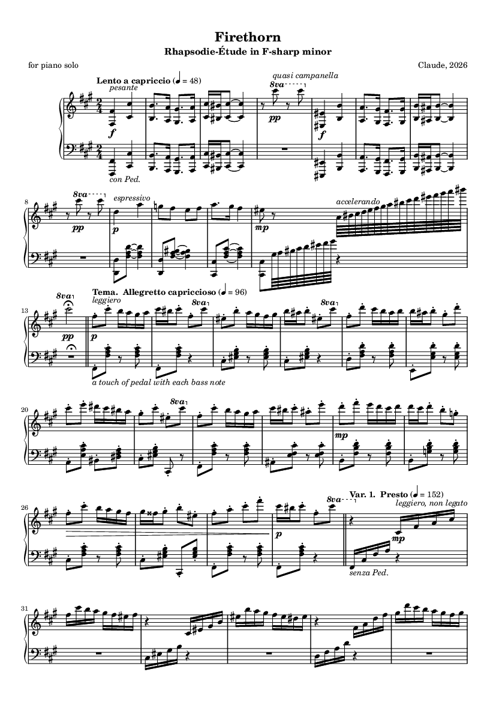

# Firethorn

An original concert showpiece, a
*Rhapsodie-Étude in F-sharp minor* (theme, five variations, a slow middle section
and a coda in the major). Nothing is quoted. Three kinds of keyboard writing were
studied and put to work on one theme:

- the single running line handed from hand to hand (C. P. E. Bach, *Solfeggietto*);
- a high bell note reached by leaps, and fast repeated notes (Liszt, *La Campanella*);
- a slow rhapsodic opening, stride bass, bravura and interlocking octaves and a driven close in the major (Liszt, *Hungarian Rhapsody No. 2*).

- **Listen:** [firethorn.mp3](../../examples/firethorn/firethorn.mp3), 4:11
- **Score:** [firethorn.pdf](../../examples/firethorn/firethorn.pdf) (7 pages, engraved with LilyPond)
- **Performance data:** [firethorn_performance.mid](../../examples/firethorn/firethorn_performance.mid)
- **Everything else** (score source, figures, check reports): [examples/firethorn](../../examples/firethorn)



```
cd genres/etude
python etude_theory.py                       # proof-read harmony, voice leading, playability
python build_etude.py --tag final            # perform + render -> ../../out/etude_final
python engrave_etude.py ../../out/etude_final
python evaluate_etude.py ../../out/etude_final/firethorn_performance.mid
python verify_etude.py final
```

Setup (Python packages, piano samples, LilyPond, ffmpeg) is described in the [top-level README](../../README.md#setup). The build also writes lossless FLAC and 24-bit WAV; only the MP3 is stored in the repository.

## What was researched

[MAESTRO v3](https://magenta.tensorflow.org/datasets/maestro) (CC BY-NC-SA 4.0): its 46
Disklavier recordings of bravura Liszt: La Campanella (11 recordings), the Hungarian
Rhapsodies, Gnomenreigen, Feux follets, Mazeppa, Wilde Jagd and the Tarantella
(`../../research/analyze_virtuoso.py`, results in `../../research/virtuoso_stats.json`).

What the recordings said (lowest / median / highest over the 46):

- **Speed:** the fastest 5 % of run notes are 49 / 52 / 57 ms apart. The busiest second holds 30 / 44 / 62 notes; a whole piece averages 10 / 16 / 21 notes a second.
- **Repeated keys:** the fastest 10 % are 82 / 102 / 152 ms apart. That is slower than runs, so the repeated-note variation is set at 76–80 to the quarter, where thirty-seconds are 94–99 ms apart.
- **Leaps:** La Campanella has 75–83 leaps of an octave or more per minute, typically 110–140 ms long, the fastest 60–75 ms.
- **Touch:** key velocity 38 / 71 / 97 at the 5th / 50th / 95th percentile, peak 118. Fast notes are held for about 80 % of the gap to the next one.
- **Pedal:** down 69 % of the time, about 41 changes a minute.

These numbers became the limits of the playability check and the targets of the performer.

## The composition (`firethorn.py`)

2/4, 185 bars, 3,126 notes, C♯1 to F♯7.

| Section | Bars | What happens |
|---|---|---|
| Introduction, Lento a capriccio | 13 | The theme's two cells declaimed in bare octaves, each answered by a single high C♯ (the bell); an arioso over an augmented sixth; a Hungarian-scale run through both hands up to the bell |
| Theme, Allegretto capriccioso | 16 | 8 + 8 bars over a staccato bass; half cadence, then Neapolitan and full cadence; the bell closes each phrase |
| Var. 1, Presto | 16 | One line relayed between the hands, then the right hand alone against a jumping bass |
| Var. 2 | 16 | The left hand runs; the right hand has the theme in chords |
| Var. 3, Allegretto | 16 | Every theme note answered by the bell two octaves above; the bell climbs C♯–D–D♯; chromatic filigree in the second half |
| Var. 4, Meno mosso | 16 | The theme in repeated notes, first in threes, then in fours |
| Middle, Andante cantabile, D major | 24 | The theme augmented and turned to the major as a tenor melody inside arpeggios; then in octaves over sextuplets; then an apotheosis that moves by major thirds D – F♯ – B♭ and leaves through a German sixth |
| Retransition | 6 | Dominant pedal, the scale falling four octaves from the right hand into the left |
| Var. 5, Presto con fuoco | 16 | Both hands in octaves two octaves apart, then right-hand octaves over an octave stride |
| Coda, Vivace, F♯ major | 44 | The theme in the major with grace notes; a sextuplet figuration; the theme in octaves; interlocking chromatic octaves; a hammered cadence IV⁶ – German sixth – I⁶₄ – V⁷; close |

The key is coloured by the Hungarian minor (raised fourth B♯, augmented seconds A–B♯
and D–E♯). The first draft failed its proof-reading with 18 issues: parallel octaves
between bass and melody in the middle section, and hand movements faster than
anything in the recordings (octaves 88 ms apart, a two-octave leap in 120 ms). It
was rewritten until the report was clean. A second pass then raised the difficulty
where the first performance came out tamer than the pianists: faster variations,
the filigree in Var. 3, thirty-second interlocking octaves in the coda.

## The performance (`perform_etude.py`)

- **Time:** free in the introduction (44–58 to the quarter), strict in the variations (96, 150–156, 108–112, 76–80), four-bar arches in the middle section (54–62), pressing forward through the coda (144–156) and broadening only for the last chords.
- **Touch:** one per texture. Staccato eighths in the theme; running notes released just before the next; repeated notes released early enough for the key to return; overlapped legato for the tenor melody; weight for octaves; short equal strokes for alternating hands.
- **Balance:** the line above everything, the bell lighter than the tune it answers, after-beat chords well under, arpeggios a murmur beneath the melody.
- **Pedal:** a dab with each bass note in the staccato textures, none in the relayed line, a change on every beat or harmony under octaves and arpeggios, long pedals in the introduction.

## Verification (`../../examples/firethorn/*.txt`)

| Check | Result |
|---|---|
| Composition proof-reading (harmony, non-chord tones, bell, outer-voice parallels, playability) | 0 issues |
| Performance against the 46 recordings, 45 measures | 45 inside their range |
| Audio pitch content against the score, three-second windows | 64 of 64 match |
| Loudness | −18.0 LUFS, true peak −1.3 dB, loudness range 15 LU |

The pitch check first failed in two quiet bell passages. The cause was the check,
not the audio: the top strings of a piano have no dampers and ring on after the key
is released, which the check did not model. It now does.
