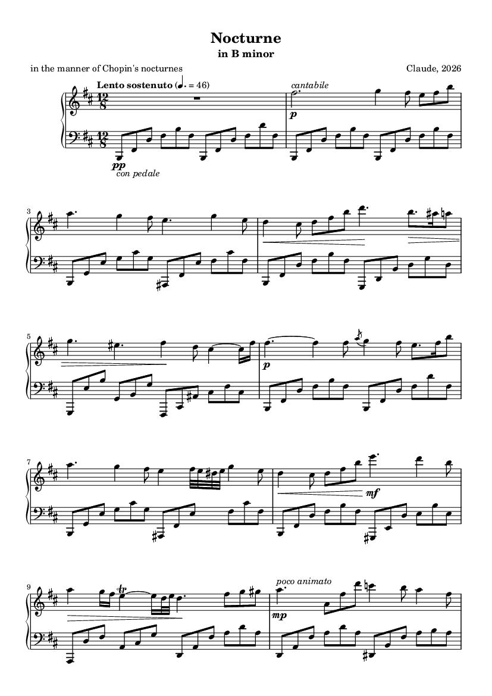

# Nocturnes

Two nocturnes live here: the Nocturne in B minor (this page) and [The Last Lamp](last_lamp/README.md), a Nocturne in F minor built on the same performer and proof-reader.

## Nocturne in B minor

An original solo-piano nocturne in the manner of Chopin, composed, performed and
recorded entirely in code. Nothing in it is quoted from Chopin; the style was
studied from his scores and from recordings of concert pianists, and both the
composition and the playing were checked against those measurements.

- **Listen:** [nocturne_b_minor.mp3](../../examples/nocturne_b_minor/nocturne_b_minor.mp3), 4:12
- **Score:** [nocturne_b_minor.pdf](../../examples/nocturne_b_minor/nocturne_b_minor.pdf) (4 pages, engraved with LilyPond)
- **Performance data:** [nocturne_b_minor_performance.mid](../../examples/nocturne_b_minor/nocturne_b_minor_performance.mid) (with continuous pedal)
- **Everything else** (score source, figures, check reports): [examples/nocturne_b_minor](../../examples/nocturne_b_minor)



> One caveat up front: no human ear was involved. Every decision was verified by
> measurement (listed under "Verification"), not by listening.

## Rebuild

```
cd genres/nocturne
python theory.py                 # proof-read the composition
python build.py --tag final      # perform + render  -> ../../out/nocturne_final
python engrave.py ../../out/nocturne_final      # score PDF
python evaluate.py ../../out/nocturne_final/nocturne_b_minor_performance.mid
python verify_audio.py final
```

Setup (Python packages, piano samples, LilyPond, ffmpeg) is described in the [top-level README](../../README.md#setup). The build also writes lossless FLAC and 24-bit WAV; only the MP3 is stored in the repository.

## What was researched

| Source | Used for |
|---|---|
| [Chopin first editions, Humdrum scores](https://github.com/pl-wnifc/humdrum-chopin-first-editions) (Fryderyk Chopin Institute, CC BY 4.0) | Style statistics of all 19 nocturnes (`../../research/analyze_scores.py`) |
| [MAESTRO v3](https://magenta.tensorflow.org/datasets/maestro) (CC BY-NC-SA 4.0) | 19 Disklavier recordings of Chopin nocturnes by competition pianists: touch, voicing, hand asynchrony, pedalling (`../../research/analyze_performances.py`) |
| [ASAP](https://github.com/fosfrancesco/asap-dataset) (CC BY-NC-SA 4.0) | Beat-level rubato in the Berceuse and Barcarolle (`../../research/analyze_tempo.py`) |
| [Salamander Grand Piano V3](https://freepats.zenvoid.org/Piano/acoustic-grand-piano.html) (Alexander Holm, CC BY 3.0) | The instrument: Yamaha C5, 16 velocity layers, 48 kHz / 24 bit |
| Musopen recordings on Wikimedia Commons (public domain) | Tonal balance and stereo image reference for mastering |
| Rothstein, ["Like Falling off a Log: Rubato in Chopin's Prelude in A-flat"](https://mtosmt.org/issues/mto.05.11.1/mto.05.11.1.rothstein.php), MTO 11.1 | Where time is taken: dissonance, augmented sixths, rising sequences |

What the measurements said (medians over the recordings):

- **Touch:** key velocity 30 / 55 / 86 at the 5th / 50th / 95th percentile. Melody about 68, bass about 46.
- **Hands:** melody and bass land within about ±18 ms of each other, either one first. Bass-before-melody is occasional, not habitual.
- **Pedal:** down 89 % of the time, about 28 changes a minute. The foot comes up about 80 ms *after* the new bass note and is back down about 100 ms later. About 15 % of the time is spent in the half-pedal range. Una corda is on about a third of the time.
- **Rubato:** bar tempo ranges from about 0.7× to 1.3× the median; the last bars slow to about 0.7×.
- **Scores:** melody moves by step a little over half the time; the left hand spans about a twelfth per bar.

## The composition (`nocturne_bm.py`)

Lento sostenuto, 12/8, 47 bars, ternary with coda.

| Bars | Section | What happens |
|---|---|---|
| 1 | Introduction | Left hand alone |
| 2–17 | A | Theme and half cadence (2–5); answer cadencing in D (6–9); rising chromatic bass D–D♯–E–E♯–F♯ to the dominant (10–13); ornamented return and perfect cadence (14–17) |
| 18–33 | B, G major | Sotto voce duet in thirds and sixths (18–25), driven upward over a chromatic bass from G to E (26–31). Climax: a German sixth with the raised fourth in the bass, the outer voices G/E♯ closing by semitone onto F♯ (31–32). Cadenza (33) |
| 34–40 | A′ | Theme with fioriture; the subdominant becomes the Neapolitan sixth over a held bass (38–39); dominant (40) |
| 41–47 | Coda | Tonic pedal. The theme remembered in minor, answered in B major; minor-subdominant sighs; closing arpeggio |

Three ideas hold it together: three rising eighths into a long appoggiatura; a
diminished third closing in on its goal (G–E♯–F♯ around the dominant, and at the
end C–A♯–B around the tonic); and the minor ninth over the dominant falling to
the root.

`theory.py` proof-reads every bar: left hand against the stated harmony, every
non-chord tone in the melody classified and resolved, parallel fifths and
octaves between the outer voices, hand spans. It found and I fixed parallel
octaves at the climax and a doubled leading tone in bar 38. Current result: 0 issues.

## The performance (`perform.py`)

- **Time:** an authored tempo plan, phrase breathing, the within-bar lilt measured on ASAP, and time simply taken (breaths, placements, fermatas). Fioriture are free inside their span; trills accelerate; grace notes fall on the beat.
- **Rubato in the narrow sense:** anticipations are sung late, upbeat figures press forward into arrivals that are then placed late.
- **Tone:** melody above everything, long notes weightier than passing ones, resolutions softer than their dissonances, low figure notes only touched.
- **Pedal:** syncopated legato pedalling with a continuous depth, half-changes inside the cadenza.

## The instrument and hall (`../../engine/piano.py`, `../../engine/hall.py`)

A sampler written for this piece: continuous damper model (half-pedal works),
register-dependent damping, release samples, sympathetic string resonance,
una corda, and a voicing regulation that evens out the sample set (its C6 was
3–5 dB weak and D♯6 too strong, right in the melody register). The hall is a
synthesised shoebox (early reflections plus a diffuse tail, about 1.8 s).

## Verification (`../../examples/nocturne_b_minor/*.txt`)

| Check | Result |
|---|---|
| Composition proof-reading | 0 issues |
| Performance against the 19 pianists, 26 measures | 26 inside their range |
| Audio pitch content against the score, bar by bar | 47 of 47 bars match |
| Tuning of all keys used | within the instrument's stretch tuning (−23 to +7 cents) |
| Loudness | −21.2 LUFS, true peak −1 dB, loudness range 15 LU |

The pitch check earned its keep: it exposed a sample-mapping bug that had every
B3 and C♯4 sounding a semitone off in earlier drafts.

## A second nocturne: The Last Lamp

[The Last Lamp](last_lamp/README.md) is a Nocturne in F minor: 60 bars in 12/8, about
5:13, written for advanced concert difficulty. A lyrical minor theme and a
relative-major duet develop through double notes, broad arpeggios and a chordal
climax into a decorated return and a quiet F-major ending. It was composed with
Codex. Its notes, harmony, form and interpretation are its own (`last_lamp/piece.py`,
`last_lamp/concert.py`); it is played by this folder's `perform.py`, proof-read by
`theory.py` and rendered by the shared engine.

- **Listen:** [the_last_lamp.mp3](../../examples/the_last_lamp/the_last_lamp.mp3)
- **Score:** [the_last_lamp.pdf](../../examples/the_last_lamp/the_last_lamp.pdf) (6 pages)
- **Details and rebuild instructions:** [last_lamp/README.md](last_lamp/README.md)
