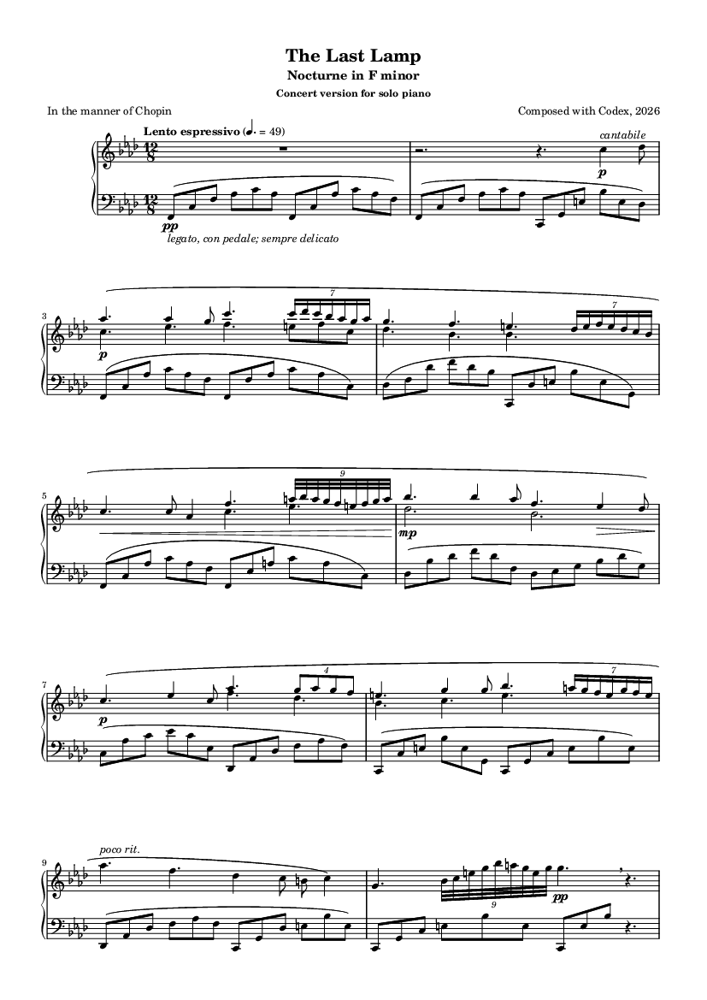

# The Last Lamp - concert version

An original nocturne in F minor for solo piano, composed with Codex on November
11, 2026 in the manner of Chopin. Lento espressivo, 12/8, 60 bars, approximately
5 minutes 13 seconds. The melody and harmony are newly authored. This version
targets advanced concert difficulty, approximately Henle 8. That is an editorial
estimate, not an official grade awarded by Henle or an examination board.

[Listen: MP3](../../../examples/the_last_lamp/the_last_lamp.mp3) ·
[Piano score: PDF](../../../examples/the_last_lamp/the_last_lamp.pdf) ·
[Expressive performance: MIDI](../../../examples/the_last_lamp/the_last_lamp_performance.mid) ·
[Notated score: MIDI](../../../examples/the_last_lamp/the_last_lamp_score.mid)



The formal framework and interpretation are in [piece.py](piece.py); the
authored concert development is in [concert.py](concert.py). The editable engraving is
[LilyPond](../../../examples/the_last_lamp/the_last_lamp.ly). The finished outputs are in
[examples/the_last_lamp](../../../examples/the_last_lamp). The build also writes lossless
FLAC and a 48 kHz / 24-bit stereo WAV to `recording/`; those are not stored in the
repository.

## The music

The theme begins with a repeated A-flat, a falling semitone, and a leap to C.
Its repeated notes leave space for the harmony to change beneath the voice.
The answering phrase grows higher and turns through a Neapolitan chord before
settling in the minor. In the middle section, the theme's rhythm opens into an
A-flat-major duet. Its lower voice moves independently of the melody.

The music becomes more urgent and chromatic through moving thirds and sixths,
octaves, and a fuller chordal texture at the climax. A German augmented sixth
resolves through a cadential six-four onto the dominant: its D-flat bass falls
to C while the upper B rises to C. A trill and a descending-then-rising cadenza
release the tension. The left hand answers across three octaves, followed by
a half-bar rest in both hands. When the theme returns, its outline is
recognisable through new fioriture and independent inner voices.
The final page remembers the darker harmonies, then sings the theme
in F major. A brief minor-subdominant shadow precedes the last quiet arpeggio.

| Bars | Character and harmonic direction |
|---|---|
| 1-2 | Quiet introduction and melodic pickup |
| 3-10 | F-minor theme; open ending on the dominant |
| 11-18 | Expanded answer and minor cadence |
| 19-26 | A-flat-major duet, with an answering inner voice |
| 27-34 | D-flat colour and increasingly urgent sequences |
| 35-38 | Chromatic approach, chordal climax, dominant arrival |
| 39-40 | Trill, cadenza, left-hand answer, and a half-bar breath before the return |
| 41-48 | Ornamented return and F-minor cadence |
| 49-52 | Neapolitan echo and suspended dominant |
| 53-60 | F-major epilogue, minor plagal inflection, fading close |

The performance has a composed tempo and dynamic plan, phrase breathing,
subtle differences in the timing of the hands, continuous sustain pedal,
una corda, and lighter releases after expressive dissonances. The main melody
is voiced above the accompaniment; the duet's second voice sits between them.
The rhythm is allowed to move through sequences and broaden at the climax.

## Technical demands and musical pacing

The difficulty comes from controlling several musical layers while maintaining
the singing line. Twenty-six bars have an independent right-hand voice. There
are extended passages in thirds and sixths, octave voicing, and full chords
within a maximum simultaneous right-hand span of an octave. Twenty-four bars
have continuous sixteenth-note left-hand arpeggios, generally spanning two or
more octaves; bar 38 begins with the same motion before settling on a held chord.
Fioriture include four notes against three accompaniment eighths, septuplets,
and longer 11- and 13-note groups. The principal cadenza has 52 written notes
after its opening trill and is marked quasi cadenza rather than treated as a
metronomic exercise.

The first two bars establish the room and the theme's pickup. The opening
statement leaves more space than its answer; the duet then replaces the rapid
left hand with a quieter accompaniment and introduces syncopated inner-voice
motion. The agitato thickens progressively into the augmented-sixth climax.
Cadential breathing is explicit in bars 10, 18, 26, 40, 48, and 52. The return
is highly decorated, but bars 47-52 release that activity before the final major
statement. The last two bars thin the accompaniment and slow naturally.

The pedal carries the preceding harmony through the finger rests in bars 10,
18, 26, 40, and 52, then clears just after the next attack. These breaths keep
the piano's natural resonance instead of clearing the strings into silence.

[Henle's difficulty guide](https://www.henle.de/Levels-of-Difficulty/) considers
texture, rhythm, instrumental technique, tone, and musical understanding, as
well as note speed. It is the reference for the approximate difficulty target;
no automated measurement can certify an official level.

## Research and sources

The composition was informed by direct reading of the local NIFC Humdrum
first-edition scores, especially Op. 9 No. 2, Op. 27 No. 2, and Op. 62 No. 1,
and the repo's score and performance research. The existing B-minor composition
was not used as a melodic template. No files in the repository's `out` directory were read,
including existing audio, scores, or generated reports. The new build has no
input paths in that directory.

- [Fryderyk Chopin Institute: digital scores of first editions](https://github.com/pl-wnifc/humdrum-chopin-first-editions).
  The different densities of accompaniment, melodic restatements, ornaments,
  and independent voices helped guide the texture. The digital encodings are
  CC BY 4.0; these were studied as reference material rather than copied into
  the new score.
- [John Henken, LA Phil: Two Nocturnes, Op. 27](https://www.laphil.com/works/two-nocturnes-op-27).
  Useful context for the relationship between vocal melody, harmonic colour,
  contrasting sections, duet writing, and major-mode codas.
- [William Rothstein, "Like Falling off a Log," Music Theory Online 11.1](https://mtosmt.org/issues/mto.05.11.1/mto.05.11.1.rothstein_essay.html).
  His analysis of rubato in Op. 28 No. 17 informed where the interpretation
  takes time, particularly at harmonic friction and near the climax. This is
  an interpretive application to a new piece, not a claim that one timing rule
  governs all Chopin.
- `research/score_stats.json`, `research/performance_stats.json`, the shared
  `engine/` (`score.py`, `piano.py`, `hall.py`, notation helpers), and the
  B-minor nocturne's `genres/nocturne/perform.py` and `genres/nocturne/theory.py`.
  The existing engine supplies notation, touch, pedalling, and piano rendering;
  the new notes, harmony, formal plan, tempo plan, dynamics, and score edition
  are in this folder.

## Rebuild and checks

From the repository root:

```powershell
python genres/nocturne/last_lamp/build.py
python genres/nocturne/last_lamp/verify.py
```

For a performance-only revision with the existing score retained, use
`python genres/nocturne/last_lamp/build.py --no-engraving`.

`--no-audio` rebuilds the notation and MIDI without rendering sound. All generated
files go to `genres/nocturne/last_lamp/recording`, outside the excluded directory. The build
uses the Python dependencies, FFmpeg, LilyPond, and piano samples described in the
[top-level README](../../../README.md#setup). Verification also uses `pypdf`.

The build checks measure durations, left-hand chord spelling, melodic
non-chord-tone resolution, sampled outer-voice parallels, simultaneous chord
spans, combined right-hand reach, and held keys shared between hands. The
independent inner voice is checked for non-chord tones resolving by step, and
the two right-hand voices are checked for conflicting claims on a held key. The
inherited checker's B-minor chromatic statistic is recomputed for F minor.
MIDI releases are trimmed before repeated strikes so old releases cannot cut
new notes short on a standard MIDI player.

The verification script decodes the MIDI and compressed audio, checks for
unreleased or overlapping repeated MIDI notes, checks audio format and peaks,
checks engraving diagnostics and PDF page count, compares the engraved MIDI's
pitch counts with the authored score, and compares each bar's audio
pitch-class spectrum with all twelve transpositions of its expected notes.
Detailed results are in [validation.json](../../../examples/the_last_lamp/validation.json).
The decoded MIDI pedal is also checked to ensure resonance continues through
all five sustained breaths.

The current build has zero score findings, 1,716 notated notes, 1,736 performed
key strikes, 19 inner-voice dissonances resolving by step, no unreleased or
overlapping repeated MIDI keys, and all 60 bars matching their expected pitch
class content. The six-page score compiles without warnings. The stereo
recording lasts 313.021 seconds and peaks below -1 dBFS.

These are automated checks. The recording has not been auditioned by a human;
spectral agreement cannot establish the correctness of every individual note
or the musical effect of the performance. The melody's relatively high share
of thirds is also a limitation of the stylistic imitation, rather than a claim
of statistical equivalence to Chopin.

## Instrument credit

Audio uses **Salamander Grand Piano V3**, sampled by **Alexander Holm**,
[CC BY 3.0](https://creativecommons.org/licenses/by/3.0/), through the repo's
custom piano and hall renderer. [Instrument source](https://freepats.zenvoid.org/Piano/acoustic-grand-piano.html).
Changes include the repo's existing retuning and voicing regulation, expressive
MIDI performance, sympathetic resonance, simulated room, and mastering. Retain
this instrument attribution when redistributing the sampled recording.
