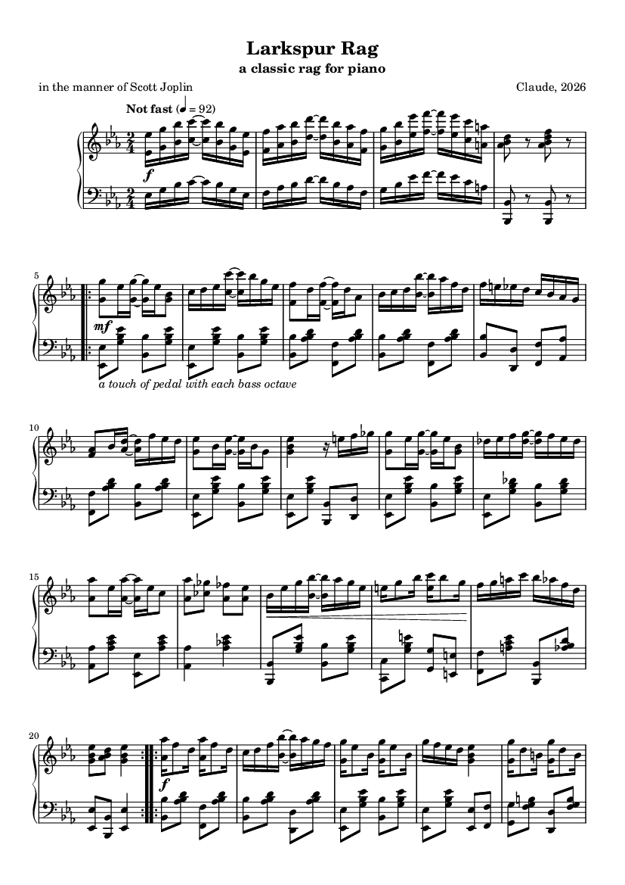

# Larkspur Rag

An original classic rag in E-flat in the
manner of Scott Joplin (no strain is quoted from him).

- **Listen:** [larkspur_rag.mp3](../../examples/larkspur_rag/larkspur_rag.mp3), 3:17
- **Score:** [larkspur_rag.pdf](../../examples/larkspur_rag/larkspur_rag.pdf) (3 pages, engraved with LilyPond)
- **Performance data:** [larkspur_rag_performance.mid](../../examples/larkspur_rag/larkspur_rag_performance.mid)
- **Everything else** (score source, figures, check reports): [examples/larkspur_rag](../../examples/larkspur_rag)



```
cd genres/ragtime
python rag_theory.py                       # proof-read + compare with Joplin
python build_rag.py --tag final            # perform + render -> ../../out/ragtime_final
python engrave_rag.py ../../out/ragtime_final
python verify_rag.py final
```

Setup (Python packages, piano samples, LilyPond, ffmpeg) is described in the [top-level README](../../README.md#setup). The build also writes lossless FLAC and 24-bit WAV; only the MP3 is stored in the repository.

## What was researched

| Source | Used for |
|---|---|
| [Joplin's works, Humdrum edition](https://github.com/craigsapp/joplin) (Craig Sapp, CC BY-NC-SA 4.0) | Rhythm, texture, bass and melodic statistics of 33 rags in 2/4 (`../../research/analyze_ragtime.py`), and Joplin's own tempo markings |
| [Bill Edwards, "Tempos and Pedaling in Ragtime Performance"](https://ragpiano.com/ragtime6.shtml) | Pedalling and touch |
| [Classic rag](https://en.wikipedia.org/wiki/Classic_rag) | Form |

What the scores said (medians over the 33 rags):

- **Rhythm:** about 30 % of bars tie a note over the middle of the bar; about 19 % use the untied short-long-short figure; about 5 attacks per bar in the right hand.
- **Texture:** about 45 % of right-hand attacks are chords, about 12 % bare octaves. The left hand plays the march bass in only about 55 % of bars.
- **Register:** melody centred on E-flat 5; the bass octave's lower note centred on F2.
- **Tempo:** "Not fast" or "Slow march tempo" on most; Joplin's own metronome marks run from 72 to 100.

There is no dataset of recorded ragtime performances comparable to MAESTRO, so the
playing follows documented practice rather than measurements.

## The composition (`larkspur_rag.py`)

2/4, "Not fast", the classic layout Intro – AA – BB – A – CC – DD (148 bars as played).

| Strain | Key | What happens |
|---|---|---|
| Intro | E♭ | Both hands in octaves, rising sequence, stop on the dominant seventh |
| A | E♭ | A rocking motif tied over the middle of the bar, answered by scale figures; IV turning to iv before the cadence |
| B | E♭ | Starts on the dominant; a three-note cell repeated across the beats; a turn to the relative minor; a broad phrase in thirds |
| C (Trio) | A♭ | Lyrical; the phrase returns a fourth higher and darkens to the minor subdominant |
| D | E♭ | Entered through the A♭ chord the trio ended on; the rocking motif over the circle of fifths, then an octave higher in full octaves |

The first draft failed its own comparison with Joplin: the melody sat a fifth too
high, the bass a fifth too low, half the melodic intervals were thirds, and the
left hand was oom-pah in 82 % of bars. After rewriting, all 15 style measures fall
inside Joplin's range and the proof-reader reports 0 issues.

## The performance (`perform_rag.py`)

- **Time:** a steady 92 to the quarter, straight sixteenths, no rubato inside a strain. A slight sitting-back at each cadence, a breath between strains, a ritardando only in the last two bars.
- **Touch:** bass octaves held, after-beat chords short and light; single lines bound, octaves detached; the tied notes carry the accent.
- **Pedal:** down just after each bass octave and up just before the chord; none in octave runs; legato pedal in the trio.
- **Repeats:** each pass of a strain has its own dynamic level.
- **Room:** a parlour-sized space (about 1 s of reverberation) instead of the concert hall.

## Verification (`../../examples/larkspur_rag/*.txt`)

| Check | Result |
|---|---|
| Composition proof-reading | 0 issues |
| Style against 33 Joplin rags, 15 measures | 15 inside his range |
| Audio pitch content against the score, four-bar windows | 37 of 37 match |
| Loudness | −18.0 LUFS, loudness range 5 LU |
